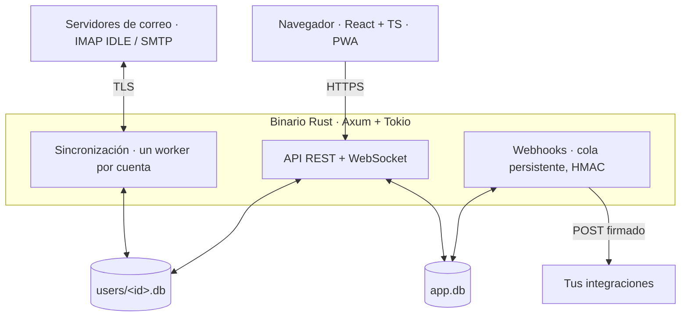

# Plan del webmail Buzón

28 oct 2026 · Javier Valencia

## Resumen

Buzón es un webmail autoalojado: backend en Rust, frontend en React, una SQLite para la aplicación y una SQLite aislada por usuario con varias cuentas de correo. Se conecta a servidores existentes por IMAP/SMTP; no es un servidor de correo. Nombre: Buzón. Licencia: MIT.

Objetivos:

- Un cliente rápido, moderno y limpio, con tema claro y oscuro.
- Todas las funciones habituales de un webmail, más un flujo de trabajo inspirado en Hey.com (el correo nuevo pasa por un filtro y se ordena por intención).
- API REST pública y Webhooks para integrar Buzón con otras herramientas.
- Fácil de desplegar: un binario y una carpeta de datos.

## Arquitectura y stack

Un único binario Rust sirve la API, el frontend compilado y los workers de sincronización. El navegador nunca habla IMAP: todo pasa por el backend, que guarda una caché local de cada buzón en la SQLite del usuario.

El navegador solo habla con la API; los workers mantienen la caché de cada cuenta y los Webhooks salen de una cola en SQLite.

| Capa | Elección propuesta | Motivo |
| --- | --- | --- |
| Servidor HTTP | Axum + Tokio | Asíncrono, maduro, buen ecosistema |
| Base de datos | SQLite con sqlx (modo WAL) | Consultas comprobadas en compilación, migraciones |
| Correo entrante | async-imap con IDLE | Avisos en tiempo real sin sondear |
| Correo saliente | lettre (SMTP) | Estándar en Rust |
| Parseo MIME | mail-parser | Rápido y completo |
| Búsqueda | SQLite FTS5 por usuario | Sin servicio extra |
| Sanear HTML | ammonia | Evita XSS en correos |
| Tiempo real | WebSocket (o SSE) | Correos nuevos al instante |
| Frontend | React + TypeScript + Vite | Lo pedido, build rápido |
| Estado y datos | TanStack Query + Zustand | Caché de servidor y estado de UI |
| Estilos | Tailwind CSS + Radix UI | Componentes accesibles, temas por variables CSS |
| Editor | TipTap | Redacción rica y limpia |
| Contrato API | OpenAPI con utoipa | Docs y cliente TypeScript generados |

Estructura del repo: un workspace Cargo (`crates/api`, `crates/sync`, `crates/store`, `crates/webhooks`) y una carpeta `web/` para React.

## Modelo de datos

Dos niveles de SQLite: `data/app.db` para lo global y `data/users/<user_id>.db` para todo el correo de cada usuario. Así un usuario se puede borrar, exportar o restaurar copiando un solo fichero, y sus datos nunca se mezclan con los de otro.

**Claves primarias:** UUIDv7 en todas las tablas, guardados como BLOB de 16 bytes (ordenados por tiempo, índices compactos). En URLs y en la API se exponen codificados en Base58 (unos 22 caracteres, sin caracteres ambiguos), por ejemplo `/threads/3xQh9tZ…`. Crates: `uuid` (v7) y `bs58`.

**app.db (aplicación)**

| Tabla | Contenido |
| --- | --- |
| users | id, email de acceso, hash Argon2id, rol (admin/usuario), 2FA, idioma, creado |
| sessions | token, usuario, dispositivo, IP, expiración |
| api\_tokens | hash del token, usuario, permisos (scopes), último uso |
| webhook\_endpoints | usuario, URL, eventos suscritos, secreto de firma, activo |
| webhook\_deliveries | endpoint, evento, intento, código de respuesta, siguiente reintento |
| settings | ajustes globales del servidor |
| audit\_log | quién hizo qué y cuándo |

**users/\<id>.db (por usuario)**

| Tabla | Contenido |
| --- | --- |
| accounts | cada cuenta de correo: nombre, dirección, IMAP/SMTP, credenciales cifradas, firma por defecto |
| identities | alias y direcciones de envío por cuenta |
| mailboxes | carpetas IMAP, UIDVALIDITY, último UID, contadores |
| messages | cabeceras, fechas, flags, hilo, bandeja Buzón (Principal/Novedades/Recibos) |
| message\_bodies | texto, HTML saneado, referencias a adjuntos |
| attachments | nombre, tipo, tamaño, ruta en disco |
| threads | agrupación de mensajes, asunto editable, fusiones |
| contacts | contactos y su estado de filtro (aprobado, bloqueado, pendiente) |
| labels / message\_labels | etiquetas propias |
| notes | notas privadas sobre hilos |
| rules | filtros automáticos |
| drafts / scheduled | borradores y envíos programados |
| messages\_fts | índice FTS5 para búsqueda |

Las contraseñas IMAP/SMTP se cifran con XChaCha20-Poly1305; la clave del usuario se deriva de una clave maestra del servidor. Más adelante (fase 7) se añadirá OAuth2 para Gmail y Outlook, para no guardar contraseñas.

## Acceso, registro y primer arranque

El usuario de Buzón y su contraseña son propios de la aplicación y no tienen nada que ver con los de sus buzones de correo.

- **Registro por invitación:** el admin genera un enlace único que caduca a las 72 h y sirve una sola vez. Al abrirlo, la persona crea su usuario y contraseña de Buzón y a continuación se le ofrece activar 2FA. Se guarda en una tabla `invitations` de app.db (hash del token, creado por, caduca, usado).
- **Credenciales separadas:** login con email y contraseña de Buzón (Argon2id, 2FA TOTP ofrecido y opcional). Las credenciales IMAP/SMTP se guardan aparte, cifradas, por cada cuenta.
- **Asistente de primer arranque:** la primera vez que se inicia la aplicación guía en pasos: crear el administrador, ajustes del servidor (URL pública, idioma, zona horaria, SMTP para avisos), tema y modo de trabajo, y añadir la primera cuenta de correo con prueba de conexión.
- **Asistente de usuario:** cada usuario nuevo pasa por una versión corta: tema, modo y primera cuenta.

**Modos de trabajo** (se cambian en cualquier momento desde Ajustes o la paleta de comandos):

| Ajuste | Opciones |
| --- | --- |
| Modo | **Clásico:** carpetas IMAP y orden por fecha. **Enfoque:** filtro de remitentes, bandejas Principal, Novedades y Recibos, Responder luego y Apartar (inspirado en Hey) |
| Vista de cuentas | **Por cuenta:** una cuenta cada vez. **Unificada:** todas combinadas, con un color por cuenta |

Por defecto: Enfoque. Cambiar de modo no borra nada: las clasificaciones de Enfoque se guardan siempre y solo cambia la vista.

## Funcionalidades habituales

El mínimo que cualquiera espera de un webmail:

- **Cuentas:** varias por usuario, bandeja unificada o por cuenta, alias e identidades, firmas.
- **Leer:** vista por hilos, carpetas IMAP, marcar leído, destacar, archivar, mover, borrar, spam.
- **Escribir:** editor rico y texto plano, responder, responder a todos, reenviar, adjuntos con arrastrar y soltar, borradores autoguardados.
- **Buscar:** texto completo con filtros (de, para, fecha, adjuntos, etiqueta, cuenta).
- **Organizar:** etiquetas, filtros automáticos, acciones en lote, deshacer.
- **Contactos:** libreta automática, autocompletado, importar vCard.
- **Avisos:** notificaciones del navegador y PWA instalable en móvil.
- **Productividad:** atajos de teclado (estilo Gmail), envío programado, deshacer envío, respuesta automática de vacaciones.
- **Privacidad:** imágenes remotas bloqueadas por defecto, HTML saneado.
- **Cuenta:** 2FA (TOTP), sesiones activas, exportar mis datos, toda la interfaz en español e inglés desde el inicio, con i18n preparada para añadir más idiomas.

## Funcionalidades nuevas

Estas funciones forman el modo Enfoque. La idea central, tomada de Hey.com: el usuario decide quién puede escribirle y el correo se ordena por intención, no por fecha. Las referencias a Hey son de memoria, no de una revisión de su web hoy.

**Inspiradas en Hey.com**

| Función | Qué hace |
| --- | --- |
| Filtro de remitentes | El primer correo de un remitente nuevo espera en «Por aprobar»; sí o no con un clic |
| Tres bandejas | Principal (personas), Novedades (boletines, para leer como un feed) y Recibos (facturas, envíos) |
| Responder luego | Pila de correos pendientes de contestar y modo «responder en bloque» |
| Apartar | Pila temporal de correos que hay que tener a mano |
| Reaparecer | El correo vuelve arriba en una fecha o si nadie ha contestado |
| Recortes | Guardar un fragmento de un correo para consultarlo después |
| Notas privadas | Notas propias sobre un hilo, invisibles al remitente |
| Fusionar y renombrar hilos | Unir conversaciones partidas y poner un asunto útil |
| Bloqueo de píxeles espía | Detecta y elimina rastreadores, y avisa de quién los usa |

**Propias de Buzón**

| Función | Qué hace |
| --- | --- |
| Paleta de comandos (Ctrl+K) | Todo el correo manejable desde el teclado |
| Resumen diario | Un correo o vista con lo importante del día y lo que espera respuesta |
| Seguimiento de respuestas | Avisa si un correo enviado no tuvo respuesta en N días |
| Alias desechables | Crear direcciones por servicio (si el proveedor lo permite) y cortarlas cuando haya spam |
| Cancelar suscripción con un clic | Usa la cabecera List-Unsubscribe |
| Plantillas y respuestas rápidas | Con variables (nombre, fecha) |
| Modo concentración | Horario sin notificaciones; solo pasan contactos VIP |
| Reglas que disparan Webhooks | «Si llega una factura de X, llama a esta URL» |
| Asistente IA (aparcado) | Fuera del alcance por ahora; se retomará más adelante |

## API y Webhooks

El propio frontend usa la misma API pública, así que todo lo que hace la web se puede hacer por API. Versión en la ruta (`/api/v1`), JSON, especificación OpenAPI 3.1 generada desde el código (siempre al día) y visor público (Scalar o Swagger UI), accesible sin iniciar sesión, en `/api/docs`.

**Autenticación**

- Web: cookie de sesión HttpOnly + protección CSRF.
- Integraciones: tokens personales con permisos (`mail:read`, `mail:send`, `contacts`, `webhooks`), revocables.
- Límite de peticiones por token.

**Recursos principales**

| Recurso | Operaciones |
| --- | --- |
| /accounts | listar, crear, probar conexión, borrar |
| /mailboxes | listar carpetas y contadores |
| /threads, /messages | listar con filtros y paginación por cursor, leer, mover, marcar, etiquetar |
| /messages/send, /drafts | enviar, programar, guardar borrador |
| /attachments | subir y descargar |
| /search | búsqueda de texto completo |
| /contacts, /screener | contactos, aprobar o bloquear remitentes |
| /labels, /rules | gestión |
| /webhooks | alta, prueba, historial de entregas |
| /events (WebSocket) | cambios en tiempo real para la web |

**Webhooks**

- Eventos: `message.received`, `message.sent`, `message.read`, `message.moved`, `thread.labeled`, `contact.screened`, `account.sync_failed`.
- Cuerpo JSON con id del evento, tipo, fecha y datos.
- Firma HMAC-SHA256 en la cabecera `Buzon-Signature`, con marca de tiempo para evitar repeticiones.
- Reintentos con espera exponencial (hasta 24 h), historial visible y botón de reenviar.
- Cola persistente en SQLite para no perder eventos si el servidor se reinicia.

## Diseño visual

Limpio y tranquilo: mucho espacio en blanco, una tipografía muy legible, un color de acento y nada de ruido visual.

- **Temas:** claro, oscuro y «seguir al sistema». Todo el color sale de variables CSS (tokens), así un tema nuevo es solo un fichero.
- **Acento:** elegible por el usuario (6 opciones), con contraste AA comprobado en ambos temas.
- **Layout:** barra lateral plegable (cuentas, bandejas, etiquetas), lista y lector. En móvil, una columna con gestos (deslizar para archivar o apartar).
- **Densidad:** cómoda o compacta.
- **Lectura:** los correos HTML se muestran en un iframe aislado; en tema oscuro se adaptan los colores sin romper el diseño del correo.
- **Movimiento:** transiciones cortas (150 ms) y respeto a «reducir movimiento».
- **Accesibilidad:** navegación completa por teclado, foco visible, lectores de pantalla.
- **Antes de programar:** un prototipo navegable (`prototype/index.html`) de las 5 pantallas clave: bandeja, lector, redactar, filtro de remitentes y ajustes.

**Responsive, pensado para leer**

Buzón se diseña primero para móvil y crece hacia escritorio. La regla: aprovechar el espacio sin apretar la información.

| Pantalla | Ancho | Distribución |
| --- | --- | --- |
| Móvil | menos de 640 px | Una columna: lista o lector; barra de acciones abajo, al alcance del pulgar |
| Tableta | 640 a 1024 px | Lista y lector lado a lado; barra lateral como panel deslizable |
| Escritorio | más de 1024 px | Barra lateral, lista y lector; la barra lateral se puede plegar |

- Ancho de lectura limitado a unos 70 caracteres por línea, aunque la pantalla sea grande.
- Interlineado 1,5 y espaciado generoso; la densidad compacta reduce márgenes, nunca el tamaño del texto.
- Cabeceras que se ocultan al desplazarse hacia abajo y vuelven al subir.
- Zonas táctiles de al menos 44 px en móvil.

**Tipografía**

- **Por defecto:** Atkinson Hyperlegible Next, creada para máxima legibilidad (distingue bien l, I, 1, O y 0).
- **A elegir:** Inter, Source Sans 3, IBM Plex Sans, Lexend, OpenDyslexic y la fuente del sistema. Una fuente monoespaciada aparte para código y texto plano.
- **Tamaño:** ajustable del 87,5 % al 150 % (por defecto 100 % = 16 px), con vista previa al momento. Todo el diseño usa unidades relativas, así que crece sin romperse.
- Fuentes alojadas en el propio servidor, sin depender de Google Fonts.

## Manual de usuario

Un solo manual en dos formatos, online y PDF, con la misma imagen que la aplicación, ambos accesibles desde el menú de ayuda.

- **Fuente única:** Markdown en `docs/manual/` del repo, en español e inglés.
- **Online:** web estática con VitePress, servida en `/manual`, que usa los mismos tokens de color, tipografía y temas claro y oscuro que la app.
- **PDF:** generado en el build a partir de las mismas páginas y CSS (impresión con Playwright), con portada y índice; descargable en `/manual/buzon.pdf`.
- **Coherencia:** capturas generadas automáticamente con Playwright en cada versión, para que nunca queden viejas.
- **Ayuda contextual:** cada pantalla enlaza a su apartado del manual.

## Seguridad, sincronización y rendimiento

**Seguridad**

- Contraseñas con Argon2id, 2FA TOTP, bloqueo tras intentos fallidos.
- Credenciales de correo cifradas en reposo; la clave maestra fuera de la base de datos (variable de entorno o fichero).
- HTML de correos saneado y mostrado en iframe con sandbox y CSP estricta.
- Proxy de imágenes para no revelar la IP del usuario.
- TLS obligatorio con IMAP/SMTP; aviso si un servidor no lo ofrece.

**Sincronización**

- Un worker por cuenta: sincroniza al conectar y luego escucha con IMAP IDLE.
- Guarda cabeceras al momento y descarga cuerpos bajo demanda o en segundo plano.
- Las acciones del usuario se aplican al momento en local y se envían a IMAP en cola, con reintento.
- Las bandejas propias (Principal, Novedades, Recibos, Apartar) viven en Buzón, no en el servidor IMAP, para no ensuciar otras apps.

**Rendimiento**

- Objetivo: lista de 50 hilos en menos de 100 ms y búsqueda en menos de 200 ms con 100.000 mensajes.
- Listas virtualizadas en el frontend y precarga del siguiente correo.
- Adjuntos en disco, no en la base de datos.

**Calidad**

- Tests de Rust con un servidor IMAP de pruebas (Greenmail o Dovecot en Docker).
- Tests del frontend con Vitest y Playwright.
- CI en GitHub Actions: formato, clippy, tests y build.

## Despliegue en producción

Buzón corre como servicio systemd detrás de nginx, con certificados de Let's Encrypt.

- **Binario:** `/usr/local/bin/buzon`, escuchando solo en `127.0.0.1:8080`.
- **Datos:** `/var/lib/buzon` (app.db, users/, adjuntos); configuración en `/etc/buzon/config.toml`; clave maestra en un fichero con permisos 600.
- **systemd:** unidad `buzon.service` con usuario propio sin privilegios, reinicio automático y endurecimiento (`ProtectSystem`, `NoNewPrivileges`, `PrivateTmp`).
- **nginx:** TLS, HTTP/2, cabeceras de seguridad, proxy de WebSocket, límite de tamaño para adjuntos.
- **Let's Encrypt:** certbot con renovación automática por temporizador.
- **Copias:** copia diaria en caliente de las SQLite (`VACUUM INTO` o Litestream) y de los adjuntos.
- **Actualizar:** sustituir el binario y reiniciar; las migraciones se aplican solas al arrancar.

## Fases

Cada fase termina con algo usable y se revisa contigo antes de pasar a la siguiente. Sin fechas: dependen de tu ritmo y prioridades.

0. **Diseño:** prototipo de las 5 pantallas, tokens de color y aprobación del plan.
1. **Cimientos:** workspace Rust + React, CI, asistente de primer arranque, invitaciones de 72 h, login, 2FA, app.db y creación de la BD por usuario.
2. **Leer correo:** añadir cuentas IMAP, sincronización con IDLE, lista de hilos, lector seguro, temas claro y oscuro, vista por cuenta y unificada.
3. **Escribir correo:** redactar, responder, adjuntos, borradores, SMTP, firmas e identidades.
4. **Organizar:** búsqueda FTS5, etiquetas, filtros, contactos, atajos de teclado.
5. **Flujo Hey:** filtro de remitentes, Principal/Novedades/Recibos, Responder luego, Apartar, Reaparecer, notas, píxeles espía.
6. **API y Webhooks:** tokens, OpenAPI con visor público, webhooks firmados con reintentos.
7. **Extras:** paleta de comandos, envío programado, seguimiento, resumen diario, PWA, OAuth2 Gmail/Outlook.
8. **Lanzamiento:** systemd + nginx + Let's Encrypt, copias de seguridad, manual online y PDF.

## Decisiones abiertas

Todas resueltas; el plan está listo para empezar a programar.

- [x] Uso: multiusuario por invitación (enlace de 72 h).
- [x] Conexión: solo IMAP/SMTP de momento; OAuth2 para Gmail y Outlook queda para la fase 7.
- [x] Despliegue: systemd + nginx + Let's Encrypt.
- [x] Modo por defecto: Enfoque.
- [x] IA: aparcada.
- [x] Funciones: la lista se queda como está.
- [x] Nombre Buzón, licencia MIT.
- [x] Nombres de los modos: «Clásico» y «Enfoque».
- [x] Idiomas: español e inglés; otros más adelante.
